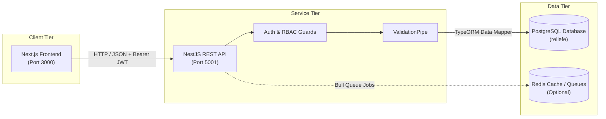

# ReliefAI Backend

[](https://nestjs.com/)
[](https://www.typescriptlang.org/)
[](https://www.postgresql.org/)
[](https://typeorm.io/)
[](http://localhost:5001/api)
[](LICENSE)

> Production-ready NestJS REST API backend for the **ReliefAI** autonomous disaster response and environmental coordination platform.

---

## 📖 Overview

The **ReliefAI Backend** delivers high-performance, resilient, and secure coordination services during critical disaster events (floods, cyclones, earthquakes). Built on **NestJS 11**, **TypeScript**, and **PostgreSQL**, the system orchestrates automated emergency triage (SOS), real-time shelter occupancy, supply chain inventory, responder dispatch, donation reconciliation, and multi-role administrative oversight.

---

## 🛠️ Tech Stack

- **Core Framework**: [NestJS 11](https://nestjs.com/) (Enterprise Node.js framework)
- **Language**: [TypeScript 5.9](https://www.typescriptlang.org/) (Strict typing mode enabled)
- **Database Engine**: [PostgreSQL 18](https://www.postgresql.org/) (Relational persistence with UUID primary keys)
- **Object Relational Mapper**: [TypeORM 0.3](https://typeorm.io/) with custom `SnakeNamingStrategy`
- **Authentication**: Stateless JSON Web Tokens ([@nestjs/jwt](https://github.com/nestjs/jwt) + [passport-jwt](http://www.passportjs.org/packages/passport-jwt/))
- **Password Cryptography**: [Argon2](https://github.com/ranisalt/node-argon2) (Memory-hard password hashing standard)
- **Access Control**: Declarative Role-Based Access Control (RBAC) via custom `@Roles()` guards
- **API Documentation**: Automated OpenAPI 3.0 / [Swagger](https://swagger.io/) UI
- **Input Validation**: Class-validator with NestJS `ValidationPipe` & Zod runtime environment schemas
- **Containerization**: [Docker](https://www.docker.com/) & Docker Compose support

---

## 🏛️ Architecture

ReliefAI follows a decoupled, 3-tier enterprise architecture:



1. **Client Tier**: Next.js 15 web application offering specialized dashboards for Citizens, First Responders, NGOs, and Government Administrators.
2. **Service Tier**: NestJS modular application handling HTTP routing, automated AI emergency triage scoring, authentication, input validation, and business logic.
3. **Data Tier**: PostgreSQL database enforcing relational constraints, indexes, timestamps, and UUID defaults.

---

## ⚡ Core Features

- **Authentication & Sessions**: Dual-token architecture with short-lived JWT Access Tokens and persistent Refresh Tokens.
- **Role-Based Authorization (RBAC)**: Fine-grained access control across 6 system roles:
  - `admin`: National emergency command, user provisioning, global auditing.
  - `citizen`: SOS emergency broadcasting, shelter lookups, relief status tracking.
  - `ngo`: Relief mission coordination, bulk supply allocation, application submission.
  - `first_responder`: Search & rescue tactical dispatch, incident status updates.
  - `volunteer`: Field distribution, victim check-in, shelter assistance.
  - `government`: Inter-agency analytics, strategic supply oversight.
- **Disaster Management**: Real-time disaster zones, severity classifications, and active boundary tracking.
- **SOS Emergency System**: Citizen distress call ingestion with automated urgency scoring (1–100) and priority triage (`CRITICAL`, `HIGH`, `MEDIUM`, `LOW`).
- **Shelter Management**: Emergency refuge directory tracking real-time capacity, current occupancy, and medical readiness.
- **Supply Management**: Inventory tracking of relief assets (water purification, dry rations, medical kits, tents).
- **Responder Management**: Unit roster, specialized skill tracking (e.g., Swift Water Rescue), status toggling, and zone assignments.
- **Donation Tracking**: Transparent record-keeping of financial contributions, payment methods, and donor allocations.
- **NGO Application System**: Verification workflow for non-governmental partner vetting and field operation approval.
- **Admin Management**: Full CRUD user directory, security status auditing, and tactical role reassignment.

---

## 🗄️ Database Schema

The database `reliefe` consists of 8 core tables:

| Table | Entity Purpose | Key Columns |
| :--- | :--- | :--- |
| **`users`** | Identity & credentials store | `id` (UUID), `name`, `email` (Unique), `password` (Argon2 Hash), `role`, `organization`, `phone`, `created_at` |
| **`disasters`** | Active & historical disaster incidents | `id` (UUID), `title`, `type` (flood/cyclone), `severity`, `status`, `location`, `affected_count`, `created_at` |
| **`sos_requests`** | Citizen distress & extraction calls | `id` (UUID), `reporter_name`, `phone`, `location` (lat/lng/address), `urgency_score`, `priority`, `needs_boat`, `status` |
| **`shelters`** | Emergency shelter facilities | `id` (UUID), `name`, `address`, `capacity`, `current_occupancy`, `has_medical`, `contact_phone`, `status` |
| **`supplies`** | Relief items & warehouse inventory | `id` (UUID), `item_name`, `category`, `quantity`, `unit`, `warehouse_location`, `status` |
| **`responder_teams`** | Rescue & tactical units | `id` (UUID), `team_name`, `team_type`, `leader_name`, `member_count`, `assigned_zone`, `status` |
| **`donations`** | Humanitarian relief funding | `id` (UUID), `donor_name`, `donor_email`, `amount`, `currency`, `payment_method`, `status`, `created_at` |
| **`ngo_applications`**| NGO partner accreditation requests | `id` (UUID), `organization_name`, `registration_number`, `contact_email`, `focus_areas`, `status` |

---

## 🔒 Security Architecture

- **Password Privacy**: The `password` field is decorated with `@Column({ select: false })` in TypeORM and filtered during serialization—passwords are **never returned in any API response**.
- **Argon2 Cryptography**: State-of-the-art memory-hard password hashing resisting GPU/ASIC brute-force dictionary attacks.
- **JWT Verification**: Strict cryptographic signature verification against `JWT_BEARER_SECRET` with configurable token lifespans.
- **RBAC Guards**: Protected endpoints enforce role requirements through `@UseGuards(JwtGuard, RolesGuard)` and `@Roles(...)`.
- **Validation Pipeline**: Global `ValidationPipe` ensures payloads conform to DTO rules (`class-validator`), stripping unwhitelisted properties.
- **Security Headers**: [Helmet](https://helmetjs.github.io/) integration configuring Content Security Policy (CSP), frameguards, and XSS filters.
- **CORS Protection**: Restricted cross-origin access configured explicitly for authorized frontend domains.

---

## 🚀 Local Setup Guide

### 1. Prerequisites
- **Node.js**: `v20.x` or `v22.x` (LTS recommended)
- **Package Manager**: [pnpm](https://pnpm.io/) (`corepack enable && corepack prepare pnpm@latest --activate`)
- **Database**: PostgreSQL 14+ (Port `5432` or custom port)
- **Redis** *(Optional)*: Required only if background queue processing is enabled.

### 2. Installation
Clone the repository and install dependencies:
```bash
git clone https://github.com/your-username/reliefai-backend.git
cd reliefai-backend
pnpm install
```

### 3. Environment Configuration
Copy the sample environment file and configure your local PostgreSQL database credentials:
```bash
cp .env.example .env
```
Edit `.env`:
```env
PORT=5001
FRONTEND_URL=http://localhost:3000

DB_CLIENT=postgres
DB_HOST=localhost
DB_PORT=5432
DB_USER=postgres
DB_PASSWORD=your_password
DB_DATABASE=reliefe

JWT_BEARER_SECRET=your_jwt_access_secret_key_here_min_32_chars
JWT_REFRESH_SECRET=your_jwt_refresh_secret_key_here_min_32_chars
```

### 4. Database Migrations
Execute TypeORM migrations to generate the database schema:
```bash
pnpm run migration:run
```

### 5. Start the Application
Run the backend in development watch mode:
```bash
pnpm run start:dev
```
For production execution:
```bash
pnpm run build
pnpm run start:prod
```

The server will initialize and begin listening on **`http://localhost:5001`**.

---

## 📑 API Documentation & Swagger

Interactive Swagger UI documentation is available directly in the browser when the server is running:

👉 **[http://localhost:5001/api](http://localhost:5001/api)**

### Core API Endpoints
| Area | Method | Endpoint | Access |
| :--- | :--- | :--- | :--- |
| **Health** | `GET` | `/health` | Public |
| **Auth** | `POST` | `/auth/login` | Public |
| **Auth** | `POST` | `/auth/register` | Public |
| **Auth** | `GET` | `/auth/me` | Authenticated |
| **Users** | `GET` | `/users` | Authenticated |
| **Disasters** | `GET` | `/disasters` | Authenticated |
| **SOS** | `POST`| `/sos` | Public / Citizen |
| **SOS** | `GET` | `/sos` | Authenticated |
| **Shelters** | `GET` | `/shelters` | Authenticated |
| **Supplies** | `GET` | `/supplies` | Authenticated |
| **Responders**| `GET`| `/responders` | Authenticated |
| **Donations** | `GET` | `/donations` | Authenticated |
| **NGOs** | `GET` | `/ngo-applications` | Admin / NGO |
| **Admin** | `GET` | `/admin/users` | Admin Only |

---

## 🧪 Testing & Verification

- **CRUD Operations**: Comprehensive test suites verified for Create, Read, Update, and Delete operations on all entities.
- **Database Verification**: PostgreSQL connection pool stability, migrations, and Argon2 password verification confirmed.
- **Zero-Error Compilation**: Verified via `pnpm run build` using the TypeScript compiler with strict type-safety.

---

## 📄 License

This project is licensed under the MIT License — see the [LICENSE](LICENSE) file for details.
